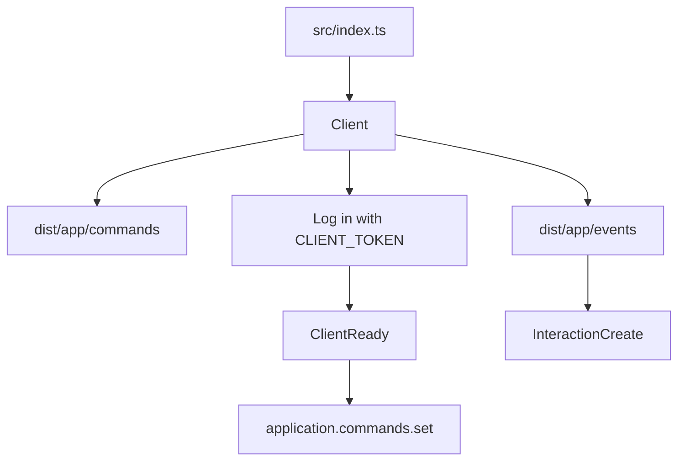

# discord.js-template

A TypeScript template for building a Discord bot. Add command and event files, and they are loaded at startup. A `/ping` slash command is included as a sample.

[](LICENSE)
[](https://discord.js.org/)
[](https://pnpm.io/)

[Overview](#overview) · [Features](#features) · [Layout](#project-layout) · [Setup](#setup) · [Usage](#usage) · [Configuration](#configuration) · [Development](#development) · [Contributing](#contributing) · [License](#license)

[日本語](README.md) · [English](README.en.md) · [한국어](README.ko.md)

---

## Overview

This repository is a starting point for a bot written with [discord.js](https://discord.js.org/) and TypeScript. Files placed in `src/app/commands` and `src/app/events` are loaded by `Client` after they are compiled to JavaScript.



## Features

### Loading commands and events

`Client` loads `.js` files under `dist/app/commands` and `dist/app/events`. A command is a default export. An event is a default export with `event` and `run`. Sources are TypeScript and must be compiled before startup.

### Application commands

Chat input, message context menu, and user context menu commands are registered and run from `InteractionCreate`. A command with `execute.autoComplete` also receives autocomplete interactions. The handler calls `deferReply` before the command runs, so the command responds with `followUp`. When `ephemeral` is true, the response is ephemeral.

### Global registration

After `ClientReady`, `application.commands.set` replaces the global commands with the loaded set.

### Admins and development mode

User IDs in `ADMINS` are admins. A command with `isAdminOnly` can be run only by an admin. When `NODE_ENV` is `development`, development mode is on and only admins can run commands. In development mode the status is `dnd`, the activity type is `Listening`, and the activity name is 「開発モードが有効です」. The log level is `debug`. Otherwise the log level is `info`.

### Permissions

In a guild, `requiredPermissions` is checked against the cached guild member.

### Error text

Error responses use a red embed. The description is loaded from `locales/ja_jp.yml` with the locale `ja_jp`. The title is 「エラーが発生しました」.

### Logging

LogTape writes to the console and to `logs/latest.log`. On startup, a non-empty `latest.log` is renamed using its modification time. The `logs` directory is gitignored.

## Project layout

```text
src/
  index.ts                 Startup and environment variables
  core/Client.ts           Loading, login, and command registration
  core/CommandHandler.ts   Holds a command definition
  core/EventHandler.ts     Holds an event definition
  app/commands/            Commands
  app/events/              Events
  lib/i18n.ts              Translations
  lib/logtape/             Logging
  types/                   Command and Client types
  utils/errorEmbed.ts      Error embed
locales/ja_jp.yml          Translation source
```

The `tsconfig.json` path alias `@/*` points at `./src/*`. Import specifiers use the `.js` extension because `module` is `nodenext`.

## Requirements

- The package manager is pnpm 12.15.0, as set in `packageManager` in `package.json`.
- This repository does not pin a Node.js version. The dependency discord.js 14.27.0 requires Node.js 18 or newer.
- A bot token from a Discord application is required.
- `Client` requests `Guilds`, `GuildMessages`, and `MessageContent`. Enable the Message Content Intent in the Developer Portal.
- Registering global commands requires the `applications.commands` scope when the bot is invited.

## Setup

> [!IMPORTANT]
> Put the bot token only in `.env`. That file is gitignored.

1. Run `pnpm install`.
2. Copy `.env.example` to `.env` and set `CLIENT_TOKEN`. Set `ADMINS` when you need admins.
3. Run `pnpm run build:tsc`.
4. Run `pnpm run build:aliases`.
5. Copy `locales/ja_jp.yml` to `dist/lib/locales/ja_jp.yml`. `package.json` has no copy script. `src/lib/i18n.ts` reads `locales` next to the running file, so `pnpm start` reads `dist/lib/locales`.
6. Start with `pnpm start`. Use `pnpm dev` for development mode. `pnpm dev` does not rebuild.

Example of step 5:

```sh
mkdir -p dist/lib/locales
cp locales/ja_jp.yml dist/lib/locales/
```

```powershell
New-Item -ItemType Directory -Force -Path dist/lib/locales
Copy-Item locales/ja_jp.yml dist/lib/locales/
```

## Usage

### Included command

`/ping` replies with the API latency and the time since the interaction was created. The implementation is `src/app/commands/info/ping.ts`.

```ts
import { CommandHandler } from '@/core/CommandHandler.js';
import { ApplicationCommandType, Colors } from 'discord.js';

export default new CommandHandler({
  name: 'ping',
  description: 'Ping the bot',
  type: ApplicationCommandType.ChatInput,
  execute: {
    interaction: async ({ client, interaction }) => {
      await interaction.followUp({
        embeds: [
          {
            title: '🏓 Pong!',
            description: `API Latency: ${client.ws.ping}ms\nClient Latency: ${Date.now() - interaction.createdTimestamp}ms`,
            color: Colors.Aqua,
          },
        ],
      });
    },
  },
});
```

### Add a command

1. Add a `.ts` file under `src/app/commands`.
2. Default-export a `CommandHandler` with `name`, `description`, and `execute.interaction`.
3. Run `pnpm run build:tsc` and `pnpm run build:aliases`, place the translation file in `dist/lib/locales`, and start the bot again.

Optional fields are defined in `src/types/CommandOptions.ts`. The runtime reads these:

| Field                  | Behavior                                                            |
| ---------------------- | ------------------------------------------------------------------- |
| `type`                 | Chat input, message, or user. Omitted type is treated as chat input |
| `ephemeral`            | When true, the response is ephemeral                                |
| `isAdminOnly`          | When true, only user IDs in `ADMINS` can run it                     |
| `requiredPermissions`  | In a guild, permissions are checked against the member cache        |
| `execute.autoComplete` | Handles autocomplete                                                |

### Add an event

Add a `.ts` file under `src/app/events` and default-export an `EventHandler`. The first argument is the event name and the second is the handler. See `src/app/events/ready/startup.ts` and `src/app/events/interactionCreate/interactionCommand.ts`.

## Configuration

| Name           | Required          | Description                                                                                             |
| -------------- | ----------------- | ------------------------------------------------------------------------------------------------------- |
| `CLIENT_TOKEN` | Required to start | Bot token. `.env.example` contains the key only                                                         |
| `ADMINS`       | Optional          | Comma-separated user IDs. Surrounding spaces and empty entries are removed                              |
| `NODE_ENV`     | Optional          | `development` turns on development mode. `pnpm dev` sets this value. It is not listed in `.env.example` |

## Development

| Script                   | What it does                                                     |
| ------------------------ | ---------------------------------------------------------------- |
| `pnpm start`             | Runs `node ./dist/index.js`                                      |
| `pnpm run build:tsc`     | Runs `tsc -p tsconfig.json`                                      |
| `pnpm run build:aliases` | Runs `tsc-alias -p tsconfig.json`                                |
| `pnpm dev`               | Runs `pnpm start` with `NODE_ENV=development`. It does not build |
| `pnpm format`            | Rewrites files with Prettier                                     |
| `pnpm check`             | Checks Prettier formatting                                       |

`package.json` has no test script. Checks to run before a contribution are listed in [CONTRIBUTING.md](CONTRIBUTING.md).

## Contributing

Issues and pull requests are welcome. See [CONTRIBUTING.md](CONTRIBUTING.md).

## License

[Apache License 2.0](LICENSE)
