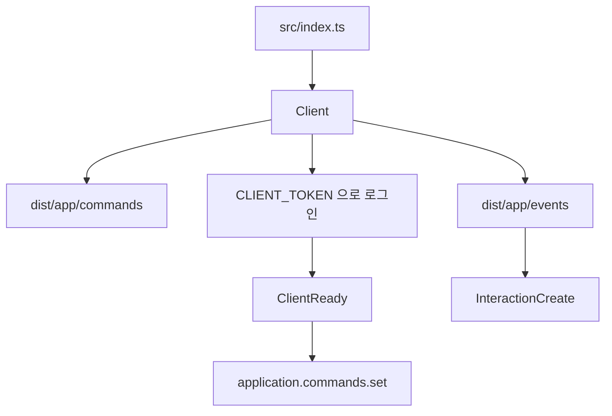

# discord.js-template

TypeScript로 Discord 봇을 만들기 위한 템플릿입니다. 명령과 이벤트 파일을 추가하면 시작 시 불러옵니다. 샘플로 슬래시 명령 `/ping`이 들어 있습니다.

[](LICENSE)
[](https://discord.js.org/)
[](https://pnpm.io/)

[개요](#개요) · [기능](#기능) · [구성](#프로젝트-구성) · [설치](#설치) · [사용 방법](#사용-방법) · [환경 변수](#환경-변수) · [개발](#개발) · [기여](#기여) · [라이선스](#라이선스)

[日本語](README.md) · [English](README.en.md) · [한국어](README.ko.md)

---

## 개요

이 저장소는 [discord.js](https://discord.js.org/)와 TypeScript로 봇을 시작하기 위한 출발점입니다. `src/app/commands`와 `src/app/events`에 파일을 두면, `Client`가 컴파일된 JavaScript를 불러옵니다.



## 기능

### 명령과 이벤트 불러오기

`Client`는 `dist/app/commands`와 `dist/app/events` 아래의 `.js`를 읽습니다. 명령은 default export이고, 이벤트는 `event`와 `run`이 있는 default export입니다. 소스는 TypeScript이며 실행 전에 컴파일이 필요합니다.

### 애플리케이션 명령

채팅 입력, 메시지 컨텍스트 메뉴, 사용자 컨텍스트 메뉴를 등록하고 `InteractionCreate`에서 실행합니다. `execute.autoComplete`가 있는 명령은 자동완성도 받습니다. 실행 전에 `deferReply`하므로, 명령 안의 응답은 `followUp`을 사용합니다. `ephemeral`이 참이면 응답은 임시 메시지가 됩니다.

### 전역 등록

`ClientReady` 이후 `application.commands.set`으로 전역 명령을 불러온 명령 전체로 바꿉니다.

### 관리자와 개발 모드

`ADMINS`에 적힌 사용자 ID가 관리자입니다. `isAdminOnly` 명령은 관리자만 실행할 수 있습니다. `NODE_ENV`가 `development`이면 개발 모드가 되고, 관리자 외에는 명령을 실행할 수 없습니다. 개발 모드에서는 상태가 `dnd`가 되고, 활동 유형은 `Listening`, 이름은 「開発モードが有効です」입니다. 로그 수준은 `debug`입니다. 그 외의 로그 수준은 `info`입니다.

### 권한

길드 안에서는 실행자의 멤버 캐시에 대해 `requiredPermissions`를 확인합니다.

### 오류 문구

오류 응답은 빨간색 embed입니다. 설명은 `locales/ja_jp.yml`을 로캘 `ja_jp`로 읽습니다. 제목은 「エラーが発生しました」입니다.

### 로그

LogTape가 콘솔과 `logs/latest.log`에 출력합니다. 시작 시 내용이 있는 `latest.log`는 수정 시각의 파일 이름으로 옮깁니다. `logs`는 Git 추적 대상이 아닙니다.

## 프로젝트 구성

```text
src/
  index.ts                 시작과 환경 변수 읽기
  core/Client.ts           불러오기, 로그인, 명령 등록
  core/CommandHandler.ts   명령 정의를 담는 객체
  core/EventHandler.ts     이벤트 정의를 담는 객체
  app/commands/            명령
  app/events/              이벤트
  lib/i18n.ts              번역
  lib/logtape/             로그
  types/                   명령과 Client 타입
  utils/errorEmbed.ts      오류 embed
locales/ja_jp.yml          번역 원본
```

`tsconfig.json`의 경로 별칭 `@/*`는 `./src/*`입니다. import 확장자는 `.js`입니다. `module`이 `nodenext`이기 때문입니다.

## 요구 사항

- 패키지 관리자는 pnpm 12.15.0입니다. `package.json`의 `packageManager`에 적혀 있습니다.
- 이 저장소는 Node.js 버전을 지정하지 않습니다. 의존성 discord.js 14.27.0은 Node.js 18 이상을 요구합니다.
- Discord 애플리케이션의 봇 토큰이 필요합니다.
- `Client`는 `Guilds`, `GuildMessages`, `MessageContent`를 요청합니다. Developer Portal에서 Message Content Intent를 켜세요.
- 전역 명령을 등록하려면 봇 초대 스코프에 `applications.commands`가 필요합니다.

## 설치

> [!IMPORTANT]
> 봇 토큰은 `.env`에만 적으세요. 이 파일은 Git 추적 대상이 아닙니다.

1. `pnpm install`을 실행합니다.
2. `.env.example`을 `.env`로 복사하고 `CLIENT_TOKEN`을 설정합니다. 관리자가 필요하면 `ADMINS`도 설정합니다.
3. `pnpm run build:tsc`를 실행합니다.
4. `pnpm run build:aliases`를 실행합니다.
5. `locales/ja_jp.yml`을 `dist/lib/locales/ja_jp.yml`로 복사합니다. 복사 스크립트는 `package.json`에 없습니다. `src/lib/i18n.ts`는 실행 중인 파일과 같은 디렉터리의 `locales`를 읽으므로, `pnpm start`의 경로는 `dist/lib/locales`입니다.
6. `pnpm start`로 시작합니다. 개발 모드로 시작하려면 `pnpm dev`입니다. `pnpm dev`는 다시 빌드하지 않습니다.

5단계의 복사 예입니다.

```sh
mkdir -p dist/lib/locales
cp locales/ja_jp.yml dist/lib/locales/
```

```powershell
New-Item -ItemType Directory -Force -Path dist/lib/locales
Copy-Item locales/ja_jp.yml dist/lib/locales/
```

## 사용 방법

### 포함된 명령

`/ping`은 API 지연과 인터랙션 생성 이후의 경과 시간을 반환합니다. 구현은 `src/app/commands/info/ping.ts`입니다.

```ts
import { CommandHandler } from '@/core/CommandHandler.js';
import { ApplicationCommandType, Colors } from 'discord.js';

export default new CommandHandler({
  name: 'ping',
  description: 'Ping the bot',
  type: ApplicationCommandType.ChatInput,
  execute: {
    interaction: async ({ client, interaction }) => {
      await interaction.followUp({
        embeds: [
          {
            title: '🏓 Pong!',
            description: `API Latency: ${client.ws.ping}ms\nClient Latency: ${Date.now() - interaction.createdTimestamp}ms`,
            color: Colors.Aqua,
          },
        ],
      });
    },
  },
});
```

### 명령을 추가하기

1. `src/app/commands` 아래에 `.ts`를 추가합니다.
2. `name`, `description`, `execute.interaction`을 가진 `CommandHandler`를 default export합니다.
3. `pnpm run build:tsc`와 `pnpm run build:aliases`를 실행하고, 번역 파일을 `dist/lib/locales`에 둔 다음 봇을 다시 시작합니다.

선택 필드는 `src/types/CommandOptions.ts`에 있습니다. 실행 측에서 읽는 항목은 다음과 같습니다.

| 필드                   | 동작                                                                     |
| ---------------------- | ------------------------------------------------------------------------ |
| `type`                 | 채팅 입력, 메시지, 사용자 중 하나입니다. 생략하면 채팅 입력으로 다룹니다 |
| `ephemeral`            | 참이면 응답을 임시 메시지로 합니다                                       |
| `isAdminOnly`          | 참이면 `ADMINS`의 사용자만 실행할 수 있습니다                            |
| `requiredPermissions`  | 길드 안에서 멤버 캐시에 대해 권한을 확인합니다                           |
| `execute.autoComplete` | 자동완성을 처리합니다                                                    |

### 이벤트를 추가하기

`src/app/events` 아래에 `.ts`를 추가하고 `EventHandler`를 default export합니다. 첫 번째 인자가 이벤트 이름이고, 두 번째 인자가 핸들러입니다. 실제 예는 `src/app/events/ready/startup.ts`와 `src/app/events/interactionCreate/interactionCommand.ts`입니다.

## 환경 변수

| 이름           | 필요 여부   | 설명                                                                                             |
| -------------- | ----------- | ------------------------------------------------------------------------------------------------ |
| `CLIENT_TOKEN` | 시작에 필요 | 봇 토큰. `.env.example`에는 키만 있습니다                                                        |
| `ADMINS`       | 선택        | 쉼표로 구분한 사용자 ID입니다. 앞뒤 공백과 빈 항목은 제거합니다                                  |
| `NODE_ENV`     | 선택        | `development`일 때 개발 모드입니다. `pnpm dev`가 이 값을 설정합니다. `.env.example`에는 없습니다 |

## 개발

| 스크립트                 | 내용                                                                     |
| ------------------------ | ------------------------------------------------------------------------ |
| `pnpm start`             | `node ./dist/index.js`를 실행합니다                                      |
| `pnpm run build:tsc`     | `tsc -p tsconfig.json`을 실행합니다                                      |
| `pnpm run build:aliases` | `tsc-alias -p tsconfig.json`을 실행합니다                                |
| `pnpm dev`               | `NODE_ENV=development`로 `pnpm start`를 실행합니다. 빌드는 하지 않습니다 |
| `pnpm format`            | Prettier로 파일을 다시 씁니다                                            |
| `pnpm check`             | Prettier 차이를 확인합니다                                               |

테스트 스크립트는 `package.json`에 없습니다. 제출 전 확인은 [CONTRIBUTING.md](CONTRIBUTING.md)에 있습니다.

## 기여

Issue와 Pull Request를 받습니다. 절차는 [CONTRIBUTING.md](CONTRIBUTING.md)를 보세요.

## 라이선스

[Apache License 2.0](LICENSE)
