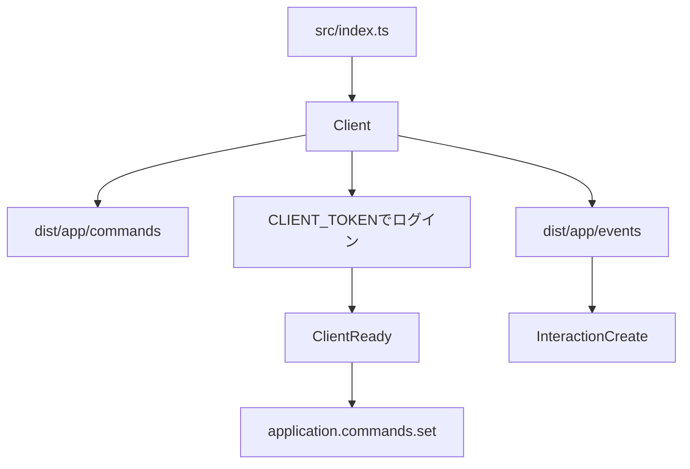

# discord.js-template

TypeScriptでDiscord Botを作るためのテンプレートです。コマンドとイベントをファイルとして追加すると、起動時に読み込まれます。サンプルとしてスラッシュコマンド`/ping`が入っています。

[](LICENSE)
[](https://discord.js.org/)
[](https://pnpm.io/)

[概要](#概要) · [機能](#機能) · [構成](#プロジェクト構成) · [セットアップ](#セットアップ) · [使い方](#使い方) · [設定](#設定) · [開発](#開発) · [貢献](#貢献) · [ライセンス](#ライセンス)

[日本語](README.md) · [English](README.en.md) · [한국어](README.ko.md)

---

## 概要

このリポジトリは、[discord.js](https://discord.js.org/)とTypeScriptでBotを書き始めるための出発点です。`src/app/commands`と`src/app/events`にファイルを置くと、`Client`がコンパイル後のJavaScriptを読み込みます。



## 機能

### コマンドとイベントの読み込み

`Client`は`dist/app/commands`と`dist/app/events`以下の`.js`を読みます。コマンドはdefault export、イベントは`event`と`run`を持つdefault exportです。ソースはTypeScriptで、実行前にコンパイルが必要です。

### アプリケーションコマンド

チャット入力、メッセージのコンテキストメニュー、ユーザーのコンテキストメニューを登録し、`InteractionCreate`で実行します。`execute.autoComplete`があるコマンドは、オートコンプリートも受けます。実行前に`deferReply`するため、コマンド内の応答は`followUp`を使います。`ephemeral`が真のとき、応答はエフェメラルになります。

### グローバル登録

`ClientReady`のあと、`application.commands.set`でグローバルコマンドを、読み込んだコマンド一式に置き換えます。

### 管理者と開発モード

`ADMINS`に書いたユーザーIDは管理者です。`isAdminOnly`のコマンドは管理者だけが実行できます。`NODE_ENV`が`development`のときは開発モードになり、管理者以外はコマンドを実行できません。開発モードではステータスが`dnd`になり、活動の種類は`Listening`、名前は「開発モードが有効です」です。ログレベルは`debug`です。それ以外のログレベルは`info`です。

### 権限

ギルド内では、実行者のメンバーキャッシュに対して`requiredPermissions`を確認します。

### エラー文言

エラー応答は赤いembedです。説明文は`locales/ja_jp.yml`をロケール`ja_jp`として読みます。タイトルは「エラーが発生しました」です。

### ログ

LogTapeがコンソールと`logs/latest.log`へ出力します。起動時、中身のある`latest.log`は更新日時のファイル名へ退避します。`logs`はGitの追跡対象外です。

## プロジェクト構成

```text
src/
  index.ts                 起動と環境変数の読み取り
  core/Client.ts           読み込み、ログイン、コマンド登録
  core/CommandHandler.ts   コマンド定義の入れ物
  core/EventHandler.ts     イベント定義の入れ物
  app/commands/            コマンド
  app/events/              イベント
  lib/i18n.ts              翻訳
  lib/logtape/             ログ
  types/                   コマンドとClientの型
  utils/errorEmbed.ts      エラーembed
locales/ja_jp.yml          翻訳の原本
```

`tsconfig.json`のパスエイリアス`@/*`は`./src/*`です。importの拡張子は`.js`です。`module`が`nodenext`のためです。

## 動作要件

- パッケージマネージャーはpnpm 12.15.0です。`package.json`の`packageManager`に書いてあります。
- このリポジトリはNode.jsのバージョンを指定していません。依存関係のdiscord.js 14.27.0はNode.js 18以上を要求します。
- DiscordアプリケーションのBotトークンが必要です。
- `Client`は`Guilds`、`GuildMessages`、`MessageContent`を要求します。Developer PortalでMessage Content Intentを有効にしてください。
- グローバルコマンドを登録するには、Bot招待時のスコープに`applications.commands`が必要です。

## セットアップ

> [!IMPORTANT]
> Botトークンは`.env`だけに書いてください。このファイルはGitの追跡対象外です。

1. `pnpm install`を実行します。
2. `.env.example`を`.env`にコピーし、`CLIENT_TOKEN`を設定します。管理者が必要なら`ADMINS`も設定します。
3. `pnpm run build:tsc`を実行します。
4. `pnpm run build:aliases`を実行します。
5. `locales/ja_jp.yml`を`dist/lib/locales/ja_jp.yml`へコピーします。コピー用のスクリプトは`package.json`にありません。`src/lib/i18n.ts`は、実行中ファイルと同じディレクトリの`locales`を読むため、`pnpm start`時の参照先は`dist/lib/locales`です。
6. `pnpm start`で起動します。開発モードで起動する場合は`pnpm dev`です。`pnpm dev`は再ビルドしません。

手順5のコピー例です。

```sh
mkdir -p dist/lib/locales
cp locales/ja_jp.yml dist/lib/locales/
```

```powershell
New-Item -ItemType Directory -Force -Path dist/lib/locales
Copy-Item locales/ja_jp.yml dist/lib/locales/
```

## 使い方

### 入っているコマンド

`/ping`はAPIレイテンシと、インタラクション作成からの経過時間を返します。実装は`src/app/commands/info/ping.ts`です。

```ts
import { CommandHandler } from '@/core/CommandHandler.js';
import { ApplicationCommandType, Colors } from 'discord.js';

export default new CommandHandler({
  name: 'ping',
  description: 'Ping the bot',
  type: ApplicationCommandType.ChatInput,
  execute: {
    interaction: async ({ client, interaction }) => {
      await interaction.followUp({
        embeds: [
          {
            title: '🏓 Pong!',
            description: `API Latency: ${client.ws.ping}ms\nClient Latency: ${Date.now() - interaction.createdTimestamp}ms`,
            color: Colors.Aqua,
          },
        ],
      });
    },
  },
});
```

### コマンドを追加する

1. `src/app/commands`以下に`.ts`を追加します。
2. `CommandHandler`をdefault exportします。`name`、`description`、`execute.interaction`を持たせます。
3. `pnpm run build:tsc`と`pnpm run build:aliases`を実行し、翻訳ファイルを`dist/lib/locales`へ置き、Botを起動し直します。

任意のフィールドは`src/types/CommandOptions.ts`にあります。実行側が読んでいるものは次のとおりです。

| フィールド             | 動作                                                                             |
| ---------------------- | -------------------------------------------------------------------------------- |
| `type`                 | チャット入力、メッセージ、ユーザーのいずれか。省略時はチャット入力として扱います |
| `ephemeral`            | 真のとき、応答をエフェメラルにします                                             |
| `isAdminOnly`          | 真のとき、`ADMINS`のユーザーだけが実行できます                                   |
| `requiredPermissions`  | ギルド内で、メンバーキャッシュに対して権限を確認します                           |
| `execute.autoComplete` | オートコンプリートを処理します                                                   |

### イベントを追加する

`src/app/events`以下に`.ts`を追加し、`EventHandler`をdefault exportします。第1引数がイベント名、第2引数がハンドラです。実例は`src/app/events/ready/startup.ts`と`src/app/events/interactionCreate/interactionCommand.ts`です。

## 設定

| 名前           | 要否       | 説明                                                                                            |
| -------------- | ---------- | ----------------------------------------------------------------------------------------------- |
| `CLIENT_TOKEN` | 起動に必要 | Botトークン。`.env.example`にキーだけあります                                                   |
| `ADMINS`       | 任意       | カンマ区切りのユーザーIDです。前後の空白と空要素は除きます                                      |
| `NODE_ENV`     | 任意       | `development`のとき開発モードです。`pnpm dev`がこの値を設定します。`.env.example`にはありません |

## 開発

| スクリプト               | 内容                                                               |
| ------------------------ | ------------------------------------------------------------------ |
| `pnpm start`             | `node ./dist/index.js`を実行します                                 |
| `pnpm run build:tsc`     | `tsc -p tsconfig.json`を実行します                                 |
| `pnpm run build:aliases` | `tsc-alias -p tsconfig.json`を実行します                           |
| `pnpm dev`               | `NODE_ENV=development`で`pnpm start`を実行します。ビルドはしません |
| `pnpm format`            | Prettierでファイルを書き換えます                                   |
| `pnpm check`             | Prettierの差分を確認します                                         |

テスト用スクリプトは`package.json`にありません。提出前の確認は[CONTRIBUTING.md](CONTRIBUTING.md)に書いてあります。

## 既知の制限

- 翻訳ファイルを`dist/lib/locales`へコピーするスクリプトはありません。
- 権限不足の翻訳キーは、コードが`core.events.interaction_command.error.permission_missing`、`locales/ja_jp.yml`が`missing_permissions`です。
- `GuildMembers` intentは要求していません。メンバーがキャッシュに無いとき、権限チェックは応答を返さずに終わります。
- `CommandOptions`には`aliases`、`canUseUserCommand`、`execute.message`があります。これらを使う処理は`src`にありません。
- `interactionCommand.ts`は、コマンド実行中の例外を捕まえていません。

## 貢献

IssueとPull Requestを受け付けています。手順は[CONTRIBUTING.md](CONTRIBUTING.md)を参照してください。

## ライセンス

[Apache License 2.0](LICENSE)
